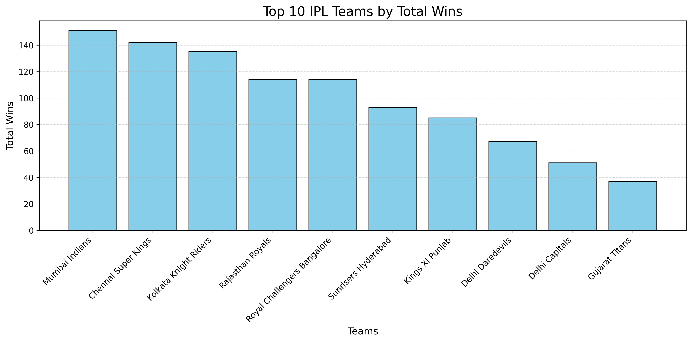
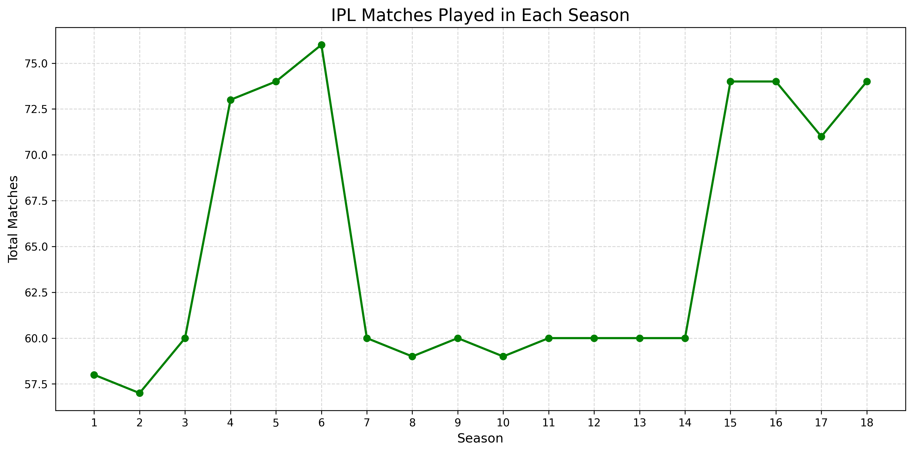
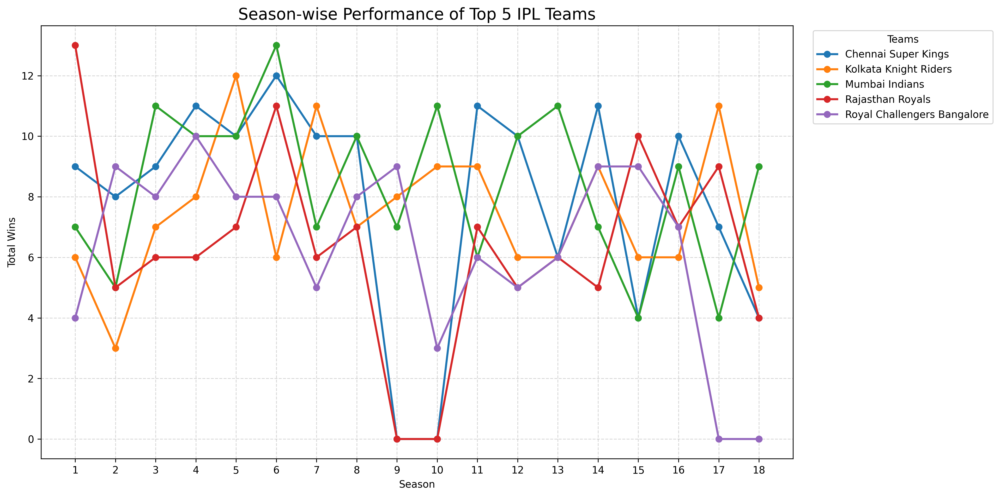
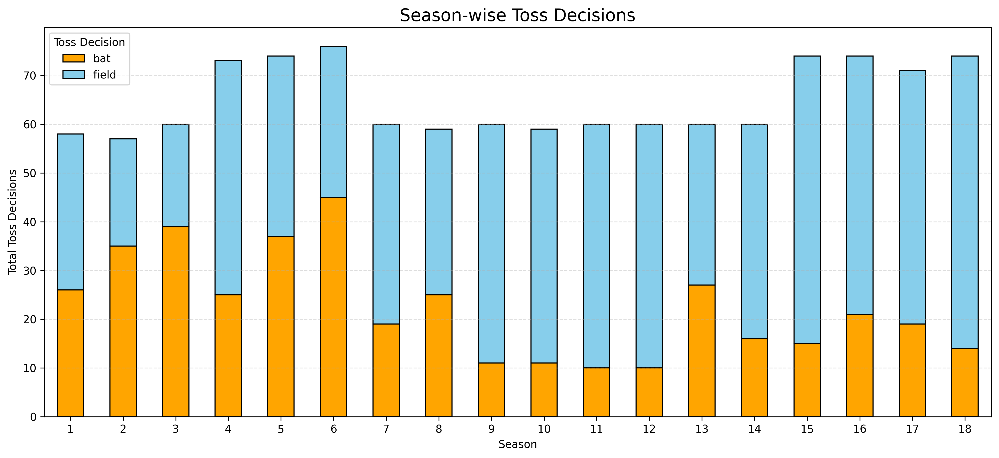
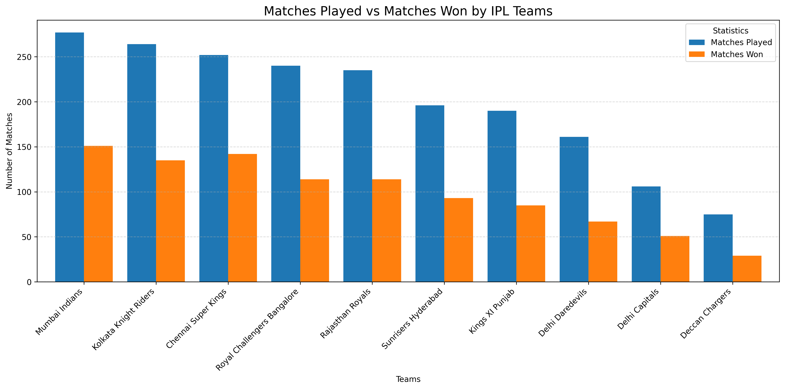
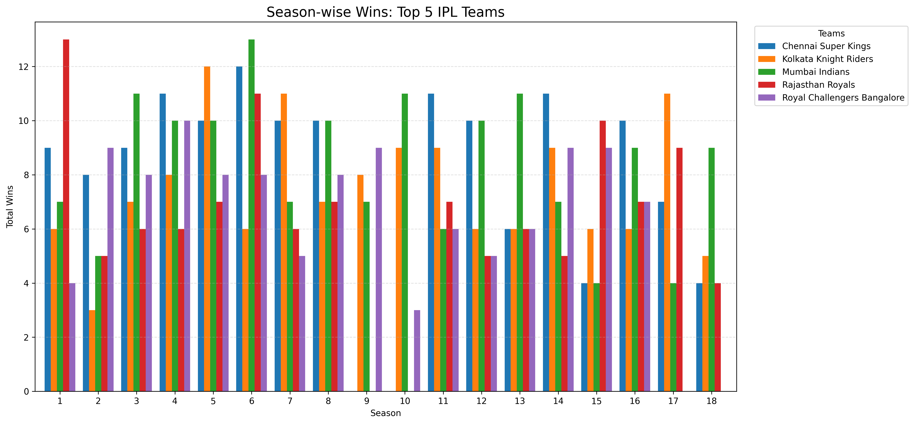

# IPL-Data-Analytics
# 🏏 IPL Data Analytics Project (2008–2025)

## 📌 About the Project

This project focuses on Exploratory Data Analysis (EDA) of Indian Premier League (IPL) match data from 2008 to 2025 using Python and Pandas in Google Colab.

The main objective is to analyze match-level data, understand team performance, explore season-wise trends, and identify meaningful patterns in IPL matches.

## 🎯 Project Objectives

- Analyze IPL matches across different seasons.
- Explore team-wise match victories.
- Identify the most successful teams in each season.
- Analyze toss decisions and match outcomes.
- Explore venue-wise match distribution.
- Analyze result margins.
- Perform data cleaning and exploratory data analysis.
- Create visualizations to communicate findings.

## 📂 Dataset

**Dataset Name:** Indian Premier League (IPL) All Matches 2008–2025

**Source:** Kaggle

[Download / View Dataset](https://www.kaggle.com/datasets/dhrubangtalukdar/indian-premier-league-ipl-all-matches2008-2025)

The dataset contains match-level information including:

- Season
- Team 1 and Team 2
- Match Date
- Toss Winner
- Toss Decision
- Match Winner
- Venue
- City
- Result
- Result Margin
- Player of the Match

## 🛠️ Tools & Technologies

- Python
- Google Colab
- Pandas
- NumPy
- Matplotlib
- Exploratory Data Analysis (EDA)

## 🔄 Project Workflow

1. Import the dataset into Google Colab.
2. Load the data using Pandas.
3. Explore dataset structure and dimensions.
4. Check missing values and duplicate records.
5. Perform data cleaning.
6. Analyze team and season performance.
7. Perform aggregations using Pandas.
8. Create charts and visualizations.
9. Interpret the analytical results.

## 📊 Analysis Performed

- Dataset overview and structure
- Missing values analysis
- Duplicate records analysis
- Season-wise match count
- Team-wise match victories
- Season-wise winning team analysis
- Toss winner vs match winner analysis
- Venue-wise match distribution
- Result margin analysis
- Data visualization

## 📈 Key Insights

The analysis explores:

- Distribution of IPL matches across seasons
- Team-wise match-winning performance
- Most successful teams in different seasons
- Relationship between toss decisions and match results
- Popular venues based on match count
- Match victory margins

*Actual numerical findings will be documented here after reviewing the notebook outputs.*

## 📁 Project Structure

```text
IPL-Data-Analytics/
│
├── notebooks/
│   └── IPL_Data_Analytics.ipynb
│
├── data/
│   └── README.md
│
├── images/
│   └── charts/
│
└── README.md
```

## ▶️ How to Run the Project

1. Download or clone this repository.
2. Open the notebook `IPL_Data_Analytics.ipynb`.
3. Upload the IPL dataset to Google Colab.
4. Run the notebook cells sequentially.
5. Explore the analysis and visualizations.

## 📚 Learning Outcomes

Through this project, I practiced:

- Python programming for data analytics
- Pandas data manipulation
- Data cleaning techniques
- GroupBy and aggregation operations
- Exploratory Data Analysis
- Data visualization
- Analytical thinking and insight generation

## 🚧 Project Limitations

This project uses match-level IPL data.

Detailed player-level batting and bowling statistics such as ball-by-ball runs, wickets, strike rates, and bowling economy require a separate ball-by-ball dataset.

## 👨‍💻 Author

BCA Student | Aspiring Data Analyst

## ⭐ Conclusion

This IPL Data Analytics project demonstrates the use of Python and Pandas to explore cricket match data, analyze team performance, and discover trends through Exploratory Data Analysis.


## 📊 Data Visualizations

### 1. Top 10 IPL Teams by Wins


### 2. IPL Matches Played in Each Season


### 3. Season-wise Wins: Top 5 IPL Teams


### 4. Season-wise Toss Decisions


### 5. Matches Played vs Matches Won


### 6. Season and Team-wise Wins

